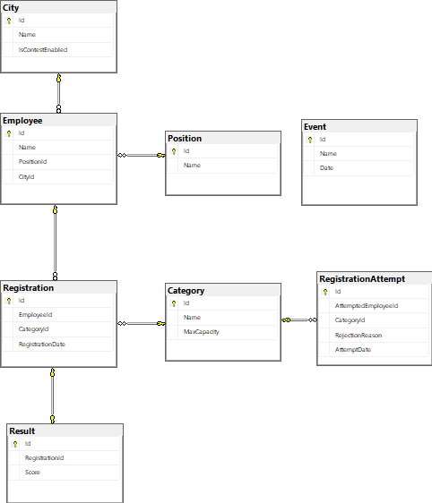

# DPDO Tecnical Test

## Overview

Backend for DPDO's internal employee contest. It exposes a REST API (Django +
Django REST Framework) on top of a SQL Server database whose schema, seed
data and stored procedures are created by the scripts in `SQL_Scripts/`. The
Django models (`DPDO_API/models.py`) are `managed = False` and map onto
those pre-existing tables.

Core rules enforced by the API:

- Only employees whose position is **Asesor** may register for the contest.
- The employee's city must have the contest enabled.
- Registrations close 3 days before the event date.
- An employee cannot register twice in the same category.
- A category cannot receive more registrations than its `MaxCapacity`.
- Only employees with position **Director** may change the event date
  (identified via the `X-Requester-Position` header, see below).
- Category winners and registration statistics are computed by SQL Server
  stored procedures (`sp_GetCategoryWinners`, `sp_GetRegistrationStatistics`),
  invoked with parametrized `EXEC` calls through `pyodbc` (`DPDO_API/procedures.py`)
  — not `cursor.callproc()`, which this driver does not support.

### How the Django app was built

`DPDO_API` was built in this order, each layer built on top of the previous
one:

**1. Models** (`DPDO_API/models.py`) — map the existing SQL Server tables
with `managed = False`, since the schema is owned by `SQL_Scripts/dpdo.sql`,
not by Django migrations.

```python
class Registration(models.Model):
    employee = models.ForeignKey(Employee, on_delete=models.DO_NOTHING, db_column='EmployeeId')
    category = models.ForeignKey(Category, on_delete=models.DO_NOTHING, db_column='CategoryId')

    class Meta:
        db_table = 'Registration'
        managed = False
```

**2. Serializers** (`DPDO_API/serializers.py`) — hold the business rules for
registration: field-level checks first (employee/category exist), then
`validate()` runs the ordered chain (position → city → closing date →
duplicate → capacity), raising a specific exception at the first rule that
fails.

```python
def validate(self, data):
    employee = Employee.objects.select_related('position', 'city').get(id=data['employee_id'])
    if employee.position.name != 'Asesor':
        raise PositionNotAllowedError()
    if not employee.city.is_contest_enabled:
        raise CityNotAllowedError()
    ...
```

**3. Exceptions** (`DPDO_API/exceptions.py`) — one `BusinessError` subclass
per business rule, each carrying its own HTTP status code, plus a custom
DRF exception handler so raising the exception is enough to produce the
right response.

```python
class CityNotAllowedError(BusinessError):
    status_code = 400
    defualt_error_message = "The employee's city is not enabled for this contest"

def business_exception_handler(exc, context):
    if isinstance(exc, BusinessError):
        return Response({'error': exc.detail}, status=exc.status_code)
    return exception_handler(exc, context)
```

**4. Procedures** (`DPDO_API/procedures.py`) — thin wrappers around the two
stored procedures, using parametrized `EXEC` (not `cursor.callproc()`,
unsupported by `pyodbc` with this driver) so the ranking/aggregation logic
stays in SQL Server instead of being recomputed in Python.

```python
def get_category_winners(category_id: int):
    with connection.cursor() as cursor:
        cursor.execute("EXEC sp_GetCategoryWinners @CategoryId = %s", [category_id])
        ...
```

**5. Views** (`DPDO_API/views.py`) — one `APIView` per endpoint, wiring
serializers/procedures to HTTP responses; `EventDateUpdateView` additionally
restricts itself with a custom permission class.

```python
class RegistrationCreateView(APIView):
    def post(self, request):
        serializer = RegistrationCreateSerializer(data=request.data)
        serializer.is_valid(raise_exception=True)
        registration = serializer.save()
        return Response({'id': registration.id, 'message': 'Registration successful.'}, status=201)
```

**6. Tests** (`DPDO_API/tests.py`) — `APITestCase` per endpoint scenario,
run against a real, disposable SQL Server database rather than mocks; see
[Testing](#testing) below for the full list.

**7. URLs** (`DPDO_API/urls.py`) — routes each endpoint under `/api/` last,
once the views existed to point to.

```python
urlpatterns = [
    path('registrations/create/', views.RegistrationCreateView.as_view(), name='registrations-create'),
    path('winners/', views.CategoryWinnersView.as_view(), name='winners'),
    ...
]
```

## Database Schema


## Endpoints

All routes are mounted under `/api/`.

| Method | URL | Body | Status codes |
|---|---|---|---|
| POST | `/api/registrations/create/` | `{"employee_id": <int>, "category_id": <int>}` | `201` created · `400` invalid body / employee's city not enabled for the contest · `403` employee's position is not Asesor · `404` employee or category does not exist · `409` employee already registered in that category / category at max capacity / registrations closed (event is less than 3 days away) |
| GET | `/api/registrations/?employee=&city=&category=&date=` | — (all query params optional: `employee` id, `city` name, `category` id, `date` `YYYY-MM-DD`) | `200` list of registrations |
| GET | `/api/winners/?category=<id>` | — | `200` top 10 registrations for the category ordered by `Score` descending, each with `Position` and `is_podium` (`Position` ≤ 3) · `400` missing or non-numeric `category` param |
| GET | `/api/statistics/` | — | `200` `{"registrations_by_advisor": [...], "unauthorized_attempts": <int>, "duplicate_attempts": <int>}` |
| PATCH | `/api/event/date/` | `{"date": "YYYY-MM-DD"}` — requires header `X-Requester-Position: Director` | `200` date updated · `400` invalid/missing date · `403` requester is not a Director |

### Response bodies

- Business-rule errors (400/403/404/409 raised by `DPDO_API/exceptions.py`) respond with `{"error": "<message>"}`.
- Field-validation errors (e.g. non-numeric `employee_id`/`category_id`) respond with DRF's default `{"<field>": ["<message>"]}` shape.
- `POST /api/registrations/create/` success: `{"id": <int>, "message": "Registration successful."}`.
- `GET /api/registrations/` items: `{"id", "employee", "city", "category", "registration_date"}`.

## Implementation plan

- 1. **Setup enviroment** Create the git repo, virtual env, connector of SQL server and dependicies for the project.
- 2. **Model Data** Modelate DataBase tables based in the core entities and problem to solve.
- 3. **SQL Development** Develop DataBase Schema with indexes, Primary Keys, Foreing Keys, Constraints defining 1:M, M:M and others
- 4. **Stored Procedures** Develop Stored Procedures for models in the API to not use SQL statements in the api
- 5. **Django Models** Create teh conection form the api to the DB to use the stored procedures for the main problem
- 6. **Business Logic** Use serializers and define how to handle each opertion 
- 7. **EndPoints** Create and expose endpoint with their own http responses
- 8. **Errors & Test** Develop Test cases and define errors status with http and exceptions
- 9. **Documentation** Create documentation for all project

## Relevant Commits
- 3ecffd609d7092918ae467821c9a97b3edb2bd08 "Implementation Step 1. Done & 2. Done": Codebase for the project with models and database

- 61d128da5019b16cdddfeac9a9ac7da04715ee6f "Step 5 & 6 Done": HTTP Exceptions/Errors development

- ab4556d6ec1b7f7e74b5234b92db472edd83e2c1 "Solving issues ensuring API functionality": Complete functionality of the API

## Testing

The automated suite in `DPDO_API/tests.py` runs against a real, disposable
SQL Server database (`test_dpdo`), not SQLite or mocked stored procedures —
`DPDO_API/test_runner.py` recreates the schema and the two stored
procedures there right after Django creates it. This requires the `DB_USER`
login to hold the `dbcreator` server role; see SETUP.md, step 7, for the
exact `GRANT`.

It covers:

| Class | Test | What it validates |
|---|---|---|
| `RegistrationCreateTests` | `test_successful_registration_returns_201` | Successful registration |
| | `test_employee_not_found_returns_404` | Employee does not exist |
| | `test_position_not_allowed_returns_403` | Position other than Asesor |
| | `test_city_not_allowed_returns_400` | City not contest-enabled |
| | `test_category_not_found_returns_404` | Category does not exist |
| | `test_duplicate_registration_returns_409` | Duplicate employee+category |
| | `test_capacity_exceeded_returns_409` | Category at `MaxCapacity` |
| | `test_registrations_closed_returns_409` | Event less than 3 days away |
| | `test_invalid_employee_id_returns_400` | Non-numeric `employee_id` |
| `RegistrationListTests` | `test_filter_by_employee` / `_city` / `_category` / `_date` | List filters, one at a time |
| `CategoryWinnersTests` | `test_returns_results_in_descending_score_order` | Real `sp_GetCategoryWinners`: `Score` descending order, `Position`/`is_podium` |
| | `test_missing_category_param_returns_400` | Missing `category` query param |
| `StatisticsTests` | `test_returns_three_expected_metrics` | Real `sp_GetRegistrationStatistics`: the 3 metrics |
| `EventDateUpdateTests` | `test_patch_without_director_header_returns_403` | PATCH without the `Director` header |
| | `test_patch_as_director_returns_200` | PATCH with the `Director` header, date persisted |
| `DatabaseConnectionTest` | `test_can_connect_to_configured_sql_server` | Direct connection to the real `dpdo` database using the `.env` credentials |

See `SETUP.md` for how to configure the database and run the project, and
run the automated test suite with `python manage.py test DPDO_API -v 2`.
